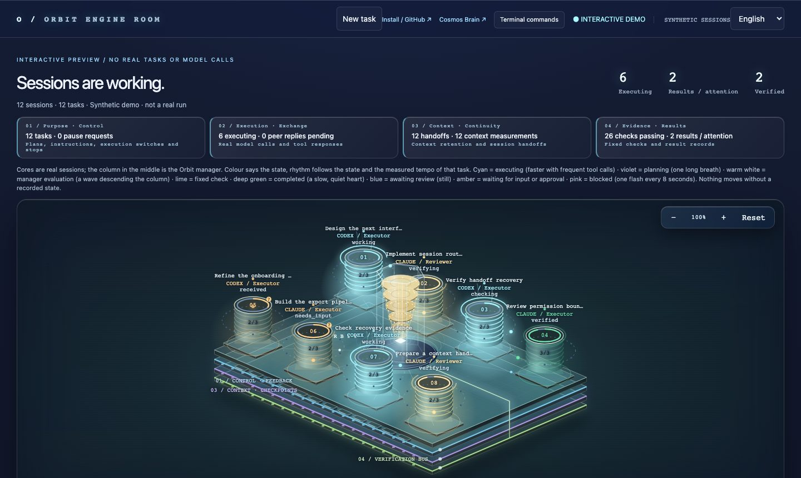

# Cosmos Orbit

**Keep your AI work in orbit.** Part of the Cosmos family: Cosmos AIOS,
[Cosmos Brain](https://github.com/honeyground-org/local-brain) and Cosmos Orbit.

[Source](https://github.com/honeyground-org/cosmos-orbit) · [Apache-2.0 licence](LICENSE) ·
[Interactive demo](https://honeyground-org.github.io/cosmos-orbit/) ·
[Cosmos Brain (local-brain)](https://github.com/honeyground-org/local-brain)

### [Launch the interactive engine room →](https://honeyground-org.github.io/cosmos-orbit/)

[](https://honeyground-org.github.io/cosmos-orbit/)

**▶ https://honeyground-org.github.io/cosmos-orbit/**

**Rotate it. Zoom in. Inspect an engine. Watch signals travel through Orbit.**

Explore 12 synthetic sessions, animated context and verification layers, attached sessions with
their live context and checkpoints, and session details directly in your browser. No installation,
account or AI calls required. This is an interactive preview of the real UI, not a recording.
GitHub README pages cannot run JavaScript, so the preview opens on GitHub Pages. It starts in
English; the language menu offers six languages and remembers your choice.


A local companion for **Codex CLI or Claude Code**. A CLI session forgets its goal when the
context is compacted, grades its own work, and ends when its process ends. Orbit is the layer
that holds what the session cannot hold for itself: the original goal and every correction,
evidence per completion item, one independent review of the completion claim, and a replayable
ledger from which handoffs and measurements are generated. Two entrances, one ledger: attach Orbit
to the session you already use, or run a request unattended in a private clone. Either engine works
alone. Brain is optional. Orbit never commits, pushes or deploys task changes.

> **Pairs with [Cosmos Brain (local-brain)](https://github.com/honeyground-org/local-brain)**, an
> open-source memory system for coding agents that lives on your machine. Orbit keeps one task on
> course; Brain carries your decisions, lessons and project context into every session. Related
> memories attach as you type, the guidance you once wrote appears right before a risky push or
> migration, and eleven MCP tools answer when the agent asks. Local index, zero dependencies,
> Apache-2.0, works with Claude Code, Codex and any MCP client.
>
> ```sh
> git clone https://github.com/honeyground-org/local-brain ~/tools/local-brain
> cd ~/tools/local-brain && ./install.sh --with-hook --with-guard
> ```

## Why Orbit does so little

Claude Code and Codex do their best work with the fewest constraints. Orbit does not start your
session, does not wrap your terminal and does not sit between you and the model. Every extra rule, planning
call, per-turn manager or wrapper costs tokens and attention, and a harness that over-manages the
model produces worse results than the CLI on its own. That gap will widen, not narrow, because the
native CLIs keep improving.

Orbit is designed from that premise. It does not plan for the model, does not manage it turn by
turn, and calls no model while nothing is wrong. It takes over only the management points a session
cannot hold for itself:

1. the original request and every later correction, fixed and re-presented after compaction and
   at the next session;
2. evidence per completion item, recorded from commands actually run;
3. one independent, read-only review of the completion claim, in a fresh context;
4. a durable ledger that survives the process, from which handoffs and measurements are generated;
5. a lean context: a long session re-reads everything on every turn, so at a measured point the work
   continues in a fresh session rebuilt from the ledger instead of dragging the whole history along.

Everything else is left to the native CLI, and Orbit judges itself by one thing: the result.

### At a glance: what Orbit does for you

| | What happens | Why it matters |
|---|---|---|
| **The goal survives** | Your request and every correction are fixed in a ledger and re-presented after compaction and in the next session. | A compacted session no longer forgets what you asked for. |
| **An independent review** | A completion claim needs evidence per item and passes one read-only review in a fresh context. | The session does not grade its own work. |
| **Handoff at a measured point** | At 350k tokens (a setting) the work continues in a fresh session rebuilt from the ledger; **in cmux or tmux Orbit types `/clear` itself** and your next request runs there. | 31–51% fewer cost-equivalent tokens on 99 real sessions; nothing to retype ([details](#context-and-mid-task-handoff)). |
| **Messages wake an idle session** | When another session (Codex or Claude Code) sends a message, **the receiving session is woken by itself** once its input line is empty. **Your own typing is never erased.** | No more typing "check it" into a session to make it read its mail ([details](#messages-between-sessions-an-idle-session-wakes-up-by-itself)). |
| **Self-evolution in two layers** | **What your use teaches stays on your machine as data; only general fixes can reach the code**, through four gates. | Orbit improves without the code becoming personal ([details](#self-evolution-agent-orbit-improves-itself-without-making-the-code-personal)). |
| **One view of all of it** | The engine room and `cosmos-orbit watch` show tasks, evidence, reviews, the handoff mode, the panes a message can wake and the self-evolution mode. | What Orbit did is visible, not assumed ([details](#observe-the-same-work)). |

## Attach Orbit to the session you already use

Requires macOS or Linux, Python 3.9+, Git, and an installed, authenticated provider CLI.
Install once:

```sh
git clone https://github.com/honeyground-org/cosmos-orbit.git
cd cosmos-orbit
./install.sh
cosmos-orbit hooks install        # SessionStart · UserPromptSubmit · Stop · PreCompact (+ SessionEnd for Claude Code)
```

The hooks are inert until something is switched on. Then use your normal command: `claude`,
`claude --dangerously-skip-permissions` or `codex`. Nothing else changes.

### Switches: three scopes, each on or off in one command

| Scope | On | Off | Lasts |
|---|---|---|---|
| Every project, every `claude` and `codex` command | `cosmos-orbit on --global` | `cosmos-orbit off --global` | until changed; stored in the Orbit store |
| One project (its Git root; run inside it, or give `PATH`) | `cosmos-orbit on` | `cosmos-orbit off` | until changed; stored per project |
| Every repository under a folder (a workspace that is not itself a repository) | `cosmos-orbit on ~/work` | `cosmos-orbit off ~/work` | until changed; the nearest switch wins, so `off` in one repository still silences it |
| One terminal session | `export ORBIT=on` (or `ORBIT=on claude`) | `export ORBIT=off` or `unset ORBIT` | that shell only |

Precedence, highest first: terminal session → project → enclosing folder → global → off. So `on --global` plus
`off` in one project means "everywhere except here", `off --global` plus `on` in a few projects
means "only there", and `ORBIT=off` silences one terminal whatever the stored switches say.
`cosmos-orbit settings` prints the global default, every project switch, the environment, and
which one applies in the current folder. Outside a Git repository, or wherever the result is off,
the hooks return nothing and cost nothing. `cosmos-orbit hooks uninstall` removes the hooks; a
backup of each host file is kept beside it.

One Codex detail: its workspace-write sandbox blocks writes outside the checkout, so the
executor's `cosmos-orbit done/evidence/claim` calls need the Orbit store added to
`sandbox_workspace_write.writable_roots` (in `~/.codex/config.toml`, or
`codex -c 'sandbox_workspace_write.writable_roots=["~/.local/share/local-harness"]'`). The hooks
themselves run outside that sandbox and need nothing. Codex asks once to trust new hooks.


Several sessions can be open in one project at once. Each session works on its own task: a new
terminal or a `/clear` only takes over an existing task when a handoff checkpoint invited it (one
taker) or when the sessions that held it have ended (Claude Code reports SessionEnd; Codex does not,
so a Codex task stays with its session until a handoff). Only a session that is new when Orbit first
sees it can take over; a session already open without a task — or one that was mid-conversation when the
switch was turned on — starts its own. A conversation resumed under a new id keeps its own task. Prompts
from one session never land in another session's task, and a session keeps its open task wherever its
shell moves (`cd` into another repository does not switch tasks). Host notifications are ignored.

What happens in an attached session:

1. The first substantial request becomes the goal; a question starts nothing. A new task keeps the
   user's last few prompts from the host's transcript as context, so a short follow-up ("fix it")
   still means something to a fresh session and to the reviewer. Every later prompt is recorded; a
   prompt that answers an open question is applied as a correction. The goal is never silently rewritten.
   Corrections typed with `cosmos-orbit feedback` are marked as command-line corrections: the
   executor's own shell can run that command, so the reviewer weighs them as claims. Your prompts
   are your words.
2. At session start, after compaction, and whenever it changed, the hook hands the executor a
   short **brief**: goal, corrections, the completion checklist with evidence counts, the last
   verdict, the stop reason, the latest checkpoint and the exact commands to record evidence and
   claim. A brief that is already in the session's context is not repeated.
3. The executor, your own session, proposes the checklist and records evidence as it works:

   ```sh
   cosmos-orbit done TASK_ID 'add(2,3) returns 5' 'subtraction is no longer used'
   cosmos-orbit evidence TASK_ID D1 --note 'verify.py passes' --command '["python3","verify.py"]'
   cosmos-orbit claim TASK_ID --summary 'add fixed' [--remaining '…'] [--wait]
   ```

4. `claim` runs the fixed checks immediately. A failure is returned to the executor, and the Stop
   hook keeps the turn open until it is fixed; nobody is asked to intervene. A pass queues one
   read-only review in a fresh context (`--wait` runs it now). Unmet items come back in the next
   brief; `verified` closes the task.
5. **Every stop is managed.** Orbit reads from the ledger why the session stopped (no model call),
   records it as the task's state (`MANAGER` line in the brief, `manager_decision` in the events) and
   gives the one next step that fits:

   | Why it stopped | What Orbit does |
   |---|---|
   | Items still have no evidence | Sends it back with those items by name (and the last checkpoint's next step) |
   | Every item has evidence, nothing claimed | Tells it to verify the result against the goal and claim |
   | The review returned unmet items | Sends back the unmet items and the reviewer's fix list |
   | A fixed check failed · the request changed | Fix the check · revise the goals, then continue |
   | Claimed, review running | Lets it stop; the supervisor waits and resumes it if the review comes back unmet |
   | A question for the user (`needs_input`) · paused · handoff | Lets it stop; nothing is resumed, no supervisor opens |
   | Verified | Complete: the review passed against the goal; the task is closed |

   A progress report or `claim --remaining` is not a reason to stop. A question the user has already
   answered no longer counts as waiting, and the executor's `--remaining` list counts only until the
   user speaks again. A claim without evidence is returned unmet.
6. A lightweight observer covers sessions that become idle anyway and reviews that return unmet after
   the executor has stopped. It starts only when the manager has work to resume or a review to wait for,
   and the session it resumes receives the manager's instruction with it. In cmux/tmux, `cosmos-orbit supervision auto` submits one continuation only
   when the bound session has an empty input line. It never clears text or interrupts a busy host.
   `cosmos-orbit supervision tell` uses notification only. This setting is separate from `context auto|tell`;
   until explicitly set it inherits that existing preference. Unsupported terminals are recorded as
   unavailable; they are not claimed to have resumed. Pause, input dependency, session replacement and
   Orbit off cancel supervision. Pending context handoffs take precedence; the supervisor waits for them.
   After two synchronous Stop blocks in one turn, the rate-limited observer takes over. Wake limits and one delivery per stopped turn prevent duplicate sends.
   The observer is a background process and opens no terminal of its own, in cmux as in tmux. It leaves
   when nothing is left to resume, or when the same state has lasted 15 minutes (60 while a review runs);
   the next Stop starts one again if one is needed. Model calls Orbit makes itself (a review, an owned
   executor) run with `ORBIT=off`, so they never show up as user sessions or tasks.
   When the pane a session's hooks named cannot be read (Codex can run hooks in its app-server daemon,
   which names the pane the first Codex of that home started in), the observer uses the one pane whose
   bottom rows name the task above an empty input line, and shows a decided outcome there; none or two,
   nothing is typed. Measured 2026-11-06 in a real cmux Codex pane whose hooks named a surface that did
   not exist: before, the session sat ten minutes with nothing typed; after, the continuation reached it
   one second after the observer started, and the automatic handoff in that pane went through as well.
7. `cosmos-orbit handoff TASK_ID --write docs/HANDOFF.md` renders the ledger as Markdown. No
   handoff is written by hand. `cosmos-orbit lessons` lists corrections repeated across tasks, the
   candidates for a guard rule.

`cosmos-orbit attach --workspace . --check '["python3","verify.py"]' --done '…' 'Your request'`
creates the same ledger explicitly, with fixed checks the model cannot change. `cosmos-orbit brief`
prints what the hooks inject. `cosmos-orbit detach` closes a task without verification.
`cosmos-orbit move-session <session> [--since <ISO time>] [--also <session>]` moves a session's requests off a
task it was bound to by mistake onto a new task of its own, with the corrections and checkpoints they made; the
old task keeps a record of what moved. It prints the plan; `--apply` does it.

### After the work: verified, reopened, closed, continued

- **Verified is done.** If the session that did the work makes another substantial request while the task is
  still open, the same task becomes `working` again and its goals are marked to revise (`REOPENED` in the brief).
  A request from another terminal starts a new task.
- **Untouched for 12 hours, a task closes** (status `closed`): a verified one (reason `verified`) and an
  unfinished one whose sessions went quiet (reason `idle`). "Untouched" counts both the task's own record and the
  last hook of every live session bound to it, so a terminal still in use keeps its task open; a task waiting for
  Orbit's own review never closes this way. Nothing is deleted, and the closed task's sessions are ended, so no new
  terminal picks it up as "nobody is on it". Every hook makes the check first, before the hook itself counts as activity.
- **A closed task comes back only when you ask.** `cosmos-orbit list --closed [--workspace .]` lists closed tasks
  with their goal, when and why they closed, and their last checkpoint. `cosmos-orbit continue TASK_ID` takes one
  back: run inside Claude Code or Codex, that session works on it from its next prompt (`--session` names another),
  and a task the session had just started for the same request closes and its requests move over. Run from a plain
  shell, the next new session in the task's folder takes it. The one exception: the session that worked on a task
  closed for inactivity comes back with a go-ahead ("이어서 진행해", "continue") — the same conversation going on, so
  the task reopens by itself (a night with the computer off closes every open task). Orbit never links a new request
  to a closed task by itself. When a new request looks like one (shared words with its goal or last checkpoints, closed within 7 days, or
  the same session), the brief names it in one line, as a suggestion.

## When the request changes

Real work keeps growing: a case is added, a feature widens, a rule changes. Every such change has to
revise what "done" means, or the review checks yesterday's task. Orbit makes that a rule instead of
a habit:

1. Each prompt is classified without a model, and **Orbit decides only the clear cases**. A go-ahead
   (`continue`, `진행해`) or a question ("did you update the README?", "잘 반영됐어?") is only
   recorded; a request ("can you also add CSV export?", "fix the login"), a short refusal ("no",
   "안돼") or added scope ("PDF too?") is a **requirement change**: it joins the corrections that bind
   the independent review, and the session gets one short notice, not the whole brief again. Host
   notifications that arrive through the same hook (background tasks, monitors, slash-command echoes)
   are ignored: only a person's words set or change a goal.
   A message that names work without asking for it ("README update?") is **unsure**, and the
   executor — which reads the whole conversation — decides. With no open task Orbit opens a *draft*:
   `done` confirms it, and a draft nobody confirmed closes by itself at the end of the turn when no
   file changed (if files changed, the executor is asked once). Inside a task it is a *possible
   change*: the claim waits for `done --add` or `done --keep`, without a Stop interruption.
   Each such decision is a label, and the labels teach **this installation**: once the executor has
   decided the same ending the same way twice, Orbit classifies it on its own. What one person's
   phrasing turns out to mean stays in that person's store; the code holds the mechanism, never
   anyone's phrases. `cosmos-orbit evolve --reset-learned` forgets it.
2. Until the result and verification goals are revised, a completion claim is refused and the Stop
   hook asks the executor once to revise them. The executor understands the change, so it writes
   the revision:

   ```sh
   cosmos-orbit done TASK_ID --add 'CSV export writes one row per item' \
     --check '["python3","-m","pytest","tests/test_csv.py"]'   # new item + new fixed check
   cosmos-orbit done TASK_ID 'D1 …' 'D2 …'                      # rewrite the executor's own items
   cosmos-orbit done TASK_ID --keep                              # the current items already cover it
   ```

3. Fixed checks can only be added, never replaced or removed. Definitions the user fixed can be
   extended with `--add` but not rewritten by the executor. Up to twelve items.
4. Every revision is kept with its number, time, origin, reason and what it added; the brief shows
   `DONE (rev N)`, and the dashboard lists the revisions.
5. A change that arrives while the review runs is queued, not lost; a verified verdict then reopens
   the work as `requirements_changed` instead of closing it.
6. Files that change while the review runs, in a folder other sessions share, do not throw the verdict
   away: unless the task's own session called a tool after the review began (read from its own
   transcript or rollout), the changes are someone else's and the verdict stands. The turn that claimed
   ends with a Stop after the review began, and that Stop alone is not work (measured 2026-11-06 in a
   real cmux Codex pane: before this, such a verdict was filed under the session's own changes, so a pass
   would have been dropped with "claim again"). Without a readable transcript any hook counts.

Unattended work follows the same rule: a correction marks the definitions stale, the executor's next
response proposes the revised set, and Orbit adopts it as a new revision. A completion claim made
while the definitions are still stale goes back to the executor instead of to the review.

## Self-evolution agent: Orbit improves itself, without making the code personal

Orbit has a built-in evolution agent. It watches for things that went wrong in Orbit itself and improves
in two layers, kept apart on purpose: what one person's use teaches stays on that person's machine as
data, and only general fixes can reach the public code.

**The personal layer is always on and never leaves your machine.** What your usage teaches is learned
from your own store and applied automatically: how you phrase a question versus a request (once the
executor has decided the same ending the same way twice, Orbit classifies it on its own) and where your
sessions should hand off. `cosmos-orbit evolve` shows it; `cosmos-orbit evolve --reset-learned` forgets
it. None of it is ever written into the code.

**The public layer is off by default; a maintainer turns it on.** It fixes repeated *defects of Orbit*,
never preferences:

| Signal (read from the ledger and `hooks.log`) | Becomes a candidate after |
|---|---|
| A hook the CLI rejected or that raised (the host shows only a usage line) | 1 occurrence |
| A provider call that failed (`needs_input` with `provider_failure`) | 2 occurrences |
| A review that rejected the verifier's own output (`verifier_rejected`) | 2 occurrences |
| A ledger someone had to correct by hand (`ledger_corrected`) | 2 occurrences |

Signals are anonymised before anything else sees them: home paths, e-mail addresses, ids and non-ASCII
text are replaced, and repeated digits are folded, so a candidate is a defect class, not a record of
your work. A hook that sees a due candidate starts one background run; runs never overlap.

One run, step by step:

1. A fresh worktree of the upstream repository at the latest `origin/main`.
2. An agent (Claude Code, with Orbit switched off for its own session) writes a failing check first,
   `tests/verify_<name>.py` built from synthetic data, then the smallest general fix. If the right fix
   is really a value or a word list tuned to one person, it answers *not a code defect* and stops.
3. Four gates, all of which must pass:
   1. **Checks:** every check passes in the worktree, and a new check fails on the base commit (it
      really captures the defect).
   2. **No personal traces:** no added line carries the user's home, name, host, addresses, ids,
      workspace paths or four words in a row from their own prompts.
   3. **No vocabulary in code:** added lines are plain ASCII. Words people use belong to the personal
      layer, as learned data.
   4. **Generality:** a fresh, read-only reviewer judges the change useful to any user, with any
      language and projects, and free of regressions.
4. The outcome depends on the mode: `propose` keeps the gated commit as a local `evolve/<candidate>`
   branch with a report; `merge` pushes it to `main` and reinstalls Orbit from the merged tree. A
   change that fails any gate is never pushed, and nothing is installed.

A candidate is tried again only when it occurs again after an attempt, at most three times, and a
fixed defect that comes back reopens its candidate. Turning the public layer on counts only what happens
from then on: defects people already fixed by hand are not candidates.

```sh
cosmos-orbit evolve                                            # mode, personal layer, candidates, recent runs
cosmos-orbit evolve --mode propose --repo ~/src/cosmos-orbit   # gated fixes kept as local branches + reports
cosmos-orbit evolve --mode merge --repo ~/src/cosmos-orbit     # maintainers: gated fixes pushed and installed
cosmos-orbit evolve --run                                      # one attempt now
cosmos-orbit evolve --mode local                               # back to learning only
```

Where it keeps its records, all under the Orbit home (`~/.local/share/local-harness` by default):
`hooks.log` (the signals), `evolve.log` (each background run), `evolve/<candidate>.md` (proposals) and the
ledger events `evolution_merged`, `evolution_proposed` and `evolution_rejected` with every gate's result.

## Context and mid-task handoff

A session re-reads its whole context on every turn, cached or not, and long contexts also dilute
the model's attention. Orbit measures each session's context from the host's own transcript (Claude
Code) or rollout (Codex) and hands the work over to a fresh session at a measured point:

1. The hooks read the current context size on every event. No model is called.
2. When a session reaches the **handoff point** (default 350k tokens) and has grown at least 60k
   since it started, the brief says so, and at the end of that turn the Stop hook asks the executor
   once for a short checkpoint: the next concrete step and what the ledger cannot know.

   ```sh
   cosmos-orbit checkpoint TASK_ID --next 'Write tests/test_mod.py for main()' \
     --notes 'mod.py extracted; app.py still imports nothing' --file mod.py
   ```

3. The next Stop tells you once. **A hook cannot clear its own session** (neither host offers that),
   so the handoff ends one of three ways:
   - **You type `/clear`** (Claude Code) or `/new` (Codex). The fresh session takes the task over and
     starts with the brief, the checkpoint and a note to open only the files it needs and not to
     repeat finished work. Nothing to copy, nothing written by hand; the ledger records the rotation.
   - **The host compacts the session itself.** The PreCompact hook writes a checkpoint from the
     ledger when the executor wrote none, the full brief returns after compaction, and the handoff
     is closed: the session is measured again from its compacted size and told again only when it
     grows past the point once more.
   - **Orbit types it (auto mode, opt-in).** In cmux or tmux something can type into the session's
     pane. With `cosmos-orbit context auto`, your next request after the checkpoint is held back and
     carried in the ledger, Orbit types `/clear` and one fixed line into the pane, and the fresh
     session takes the task over and runs that request from its brief: nothing to retype. A
     question is still answered in place (it needs the answer you just read); the next request
     hands off. Claude Code and Codex, only in cmux or tmux; elsewhere Orbit tells you, as above.
     `cosmos-orbit context tell` goes back to telling.

     **Background handoff in Claude Code (optional mod, measured 2026-11-05).** With Orbit's mod loaded, Claude
     Code clears the session and submits the carry line itself, through its own API: nothing is typed into the
     terminal, which shows only the `/clear`, the carry line and two short notices (handing off; a fresh session
     took the task over), and it works in any terminal, not only cmux or tmux. Orbit still decides: its prompt
     hook blocks the request and carries it; the mod acts only on that block and only after it took the handoff
     (`cosmos-orbit handoff-claim`), so exactly one of the mod and the typist acts. The typist waits three
     seconds for the mod, then types as before; without the mod there is no wait. The mod also empties the input,
     where Claude Code puts a blocked request back (left there, one Enter would run it twice). After the clear it
     submits the carry line only once a fresh session took the task over (`handoff-claim --taken-over TASK`,
     polled up to 20 s); otherwise it submits nothing and says so, and the request stays carried. A fresh session
     that starts outside any repository (the host was launched in a folder holding many, and the agent had cd'd
     into one) still takes over the handoff waiting in its own pane, and a bound session keeps its task while its
     shell is outside a repository (2026-11-07: four handoffs had failed this way). Measured end to
     end in tmux (Claude Code 2.1.318): the mod took the handoff 0.5 s after the block, the fresh session took the
     task over 0.4 s later and ran the carried request; the input was empty. Enable it for every session by
     adding the folder `install.sh` copies (`~/.local/share/local-harness-app/claude-mod`) to
     `CLAUDE_CODE_PLUGIN_DIRS` in the `env` block of `~/.claude/settings.json`, or for one session with
     `claude --plugin-dir <that folder>`. `cosmos-orbit context background off` makes Orbit ignore the mod (it
     hands off by typing, as without it); `cosmos-orbit context background on` turns it back on, and
     `cosmos-orbit context background` shows the switch.

     **Codex (codex-cli 0.166, measured in tmux 2026-11-05).** Codex keeps the prompt hook's block, and the
     blocked request does not come back into the input, so nothing is emptied. Orbit types `/new`, answers
     "Where should the new conversation run?" with Enter (the current worktree), and types the carry line only
     once the screen shows a fresh conversation (its logo above an empty input); the fresh session's hooks run
     when that line is submitted, and the takeover is confirmed after it. Text and an Enter that follows at once
     are read as a paste, so Enter comes after a pause (and once more if the line is still in the input). Codex
     can run hooks in its app-server daemon, which reports the pane the first Codex of that home started in, so
     the pane is confirmed by its screen (the block of this request) before anything is typed; when it is not
     the reported pane and exactly one other pane (tmux) or terminal surface (cmux, every window and workspace)
     shows it, that one is used, otherwise nothing is typed and you are told. Measured end to end: the request
     was blocked, `/new` and the question answered, the fresh Codex session took the task over 7 seconds later
     and did the carried request.

     **Codex in cmux (measured 2026-11-06 in a real cmux Codex pane).** cmux `read-screen` returns only the
     bottom rows it is asked for, while tmux `capture-pane` returns the whole pane; in a tall pane Codex's logo
     sat above the bottom 14 rows, so the fresh conversation never looked fresh and the handoff gave up after
     `/new`. Orbit reads the whole visible screen in both terminals. Measured after that: the request was
     blocked, `/new` and the question answered, and the fresh Codex session took the task over 6 seconds later
     and ran the carried request, nothing typed by hand.

     **Measured on a real session (Claude Code 2.1, cmux, 2026-11-04): the request typed after the
     checkpoint was held, `/clear` typed, and the fresh session in the same pane took the task over 2
     seconds later and ran the request from its brief.** Three rules came from the first real runs:
     the input is emptied first, because a prompt the hook blocked comes back into the input line
     (cmux receives ctrl+u only as the raw byte, one press per line); only the session in the same
     pane may take the handoff; and the carry line is typed only after that takeover, so it can never
     land in the old session.

     **Never during a turn (2026-11-05).** A request typed while the session is still working goes
     into that turn; the handoff waits for the first request after the turn ends. (Before, the
     request was held, `/clear` waited in the host's input queue, and it ran four minutes later,
     unannounced, when the turn ended.) If an automatic `/clear` fails anyway, the request is done
     exactly once: by the old session if it runs another turn (its brief shows `HELD REQUEST`), or by
     the fresh session after your `/clear`, into which Orbit then types the carry line itself once
     its input line is empty.
4. An open handoff that nobody took **expires after 12 hours** and closes on compaction, so it can
   never hand a task to an unrelated session opened later in the same folder. When several are open
   in one folder, **the pane decides**: a fresh session takes the handoff Orbit typed `/clear` for in
   its own pane first, and never one whose session is still working in another pane (it becomes
   available once that session ends). Time only orders what is left. **A takeover nobody used is
   released too**: a session that took a task over at its start, ran no turn for it, and gets its
   first request more than 12 hours later does not fold that request into the task; the request
   starts its own task, and the old task keeps its checkpoint without an open invitation (2026-11-05:
   a pane left idle overnight after a takeover received the next morning's unrelated work, which was
   recorded as corrections of the old task and handed off under its goal).
5. Unattended work does the same without you: past the point, the next executor turn starts a
   fresh native session from a ledger packet (goal, corrections, checklist, last verdict without
   tool traces, remaining work, changed files). No extra model call writes the handoff.

Why 350k: replaying 99 real Claude Code sessions from the author's last 14 days (median start 78k,
median peak 506k) with a handoff at 200k saved 31–51% of cost-equivalent tokens (input ×1, cache
write ×1.25, cache read ×0.1) whether a fresh session had to re-read 15k or 80k tokens of files; 42
Codex sessions saved 9–23%. Lower points thrashed when re-reading was heavy (150k: −286% at 80k).
Replayed again on 113 Claude Code sessions (2026-11-04), 350k still saved 32–38% while handing off
3–6× less often than 200k (150–177 handoffs instead of 444–1,075): a few points of saving traded for
far fewer interruptions, so 350k is the built-in default. Measure your own sessions before changing it:

```sh
python3 scripts/measure_context_growth.py --days 14
```

The handoff point follows the same three scopes as the on/off switch:

| Scope | Set | Off | Show |
|---|---|---|---|
| Every project | `cosmos-orbit context 400k --global` | `cosmos-orbit context off --global` | `cosmos-orbit settings` |
| One project | `cosmos-orbit context 250k` | `cosmos-orbit context off` | `cosmos-orbit context` |
| One terminal session | `export ORBIT_HANDOFF_AT=250k` | `export ORBIT_HANDOFF_AT=off` | `cosmos-orbit context` |
| Who types `/clear` | `cosmos-orbit context auto` (cmux, tmux) | `cosmos-orbit context tell` (default) | `cosmos-orbit context` |

`cosmos-orbit context on` sets the built-in point explicitly; `cosmos-orbit context reset [--global]`
removes a stored point so the next scope applies again. Unattended tasks take the point at creation;
`--context-budget TOKENS` overrides it for one task. Measurement continues when handoff is off.

**The settings file.** Every stored point and the mode live in one file, `settings.json` in Orbit's
home (`~/.local/share/local-harness/settings.json`, or `$HARNESS_HOME/settings.json`). The commands
above write it; you can also edit it by hand, and the change applies at the next hook event, with no
restart. Values are token counts or the same words the command takes (`"350k"`, `"off"`):

```json
{
  "handoff": {
    "at": 350000,
    "mode": "auto",
    "projects": { "/path/to/repo": "250k" }
  }
}
```

`cosmos-orbit context` shows the file's path and any value it had to ignore. A file that is not valid
JSON is never overwritten: the hooks fall back to the built-in point and the command asks you to fix
it. Points stored by an earlier version (in the ledger database) move into the file once, by
themselves.

## Messages between sessions: an idle session wakes up by itself

Sessions can talk to each other: Codex to Claude Code, Claude Code to Claude Code, through a mailbox
that each host reads in its hooks. **A hook runs only when something happens in that session**: you
submit a prompt, a tool call ends, a turn ends. **A session waiting at its input line runs no hook, so a
message sat unread until you typed "check it" into that session yourself**, which made you the
messenger.

**Orbit closes that gap.** Every Orbit hook records the terminal its session runs in (a cmux surface or
a tmux pane). The sender calls one command right after it delivers a message:

```sh
cosmos-orbit wake --session RECEIVER_SESSION_ID --from codex     # or --surface PANE; both repeatable
cosmos-orbit wake --session RECEIVER_SESSION_ID --check          # only report what that screen shows
```

A detached waker then looks at the receiver's screen and acts on what it sees:

| The receiving screen | What Orbit does |
|---|---|
| working (`esc to interrupt`) | `--when-busy wait` (default): waits until the turn ends, then wakes it · `--when-busy skip`: nothing, because the mailbox delivers at the next tool call or turn end |
| the input line is empty | **types one fixed line and Enter**; the receiving prompt hook delivers the message with it |
| **you are typing there** | **never erases anything**: one notification, then it waits until the input is empty |
| not an input box (a dialog, a shell) | types nothing; notifies and keeps looking |
| not in cmux or tmux | notifies only (nothing can type there) |

The line is fixed ASCII: `Orbit: a message from another session arrived. Read it and fold it into the
task; reply only if a reply is needed.` **Orbit's prompt hook recognises it: it is never recorded as
your prompt, never changes the goal, never triggers a handoff, and the session is told that the message
is another agent's words, not your instruction.**

Bounds, so two agents cannot keep each other busy: one waker per pane (it delivers every message
waiting there), at least 20 seconds between two typed wakes in one pane, at most 20 per pane per hour,
and a waker gives up after 30 minutes (the message stays in the mailbox). A pane that a newer session
took over is not woken for the old one. **Typing follows the same switch as the automatic handoff**:
`cosmos-orbit context auto` types, `cosmos-orbit context tell` only notifies.

How the screen is read (measured on Claude Code 2.1 and Codex, plain text without colours): working
shows `esc to interrupt`; Claude Code's input is the `❯` line between two rules, empty when nothing
follows it or only its `Try "…"` placeholder; Codex's input is the `›` line, empty when it shows one of
the placeholders found in its binary. **Anything else counts as your text: the safe direction.**

Verified: `tests/verify_wake.py` (screens measured from real sessions; every rule has a control, and
eight deliberate breakages each turn it red; real typing into a throwaway tmux session), and a live run
in cmux with Claude Code: with text left in the input, nothing was touched for 7 seconds and one
notification appeared; once the input was emptied, the line was typed, submitted and answered.

Connecting a mailbox is one call in its send command, for example:

```python
import shutil, subprocess
orbit = shutil.which('cosmos-orbit')
if orbit:   # best effort: a send never fails because of it
    subprocess.run([orbit, 'wake', '--from', sender, '--when-busy', 'skip' if delivers_mid_turn else 'wait',
                    '--session', receiver_session_id], capture_output=True, timeout=20)
```

Where it keeps its records, under the Orbit home: the `terminals` table (session → pane), `wake/log.jsonl`
(each waker run and its outcome), and a `message_wake` event in the receiving session's task.

## Unattended in a private clone

```sh
cosmos-orbit doctor
cosmos-orbit start --provider codex --workspace /path/to/repo \
  --check '["python3", "verify.py"]' 'Your complete request'
```

`--workspace` must be a clean, committed Git repository root. Orbit makes a private clone without
an origin remote. The source checkout, uncommitted and ignored files are not copied or changed;
submodules are currently unsupported. Review and transfer the resulting patch yourself.

Use `--provider claude` for Claude alone. Executor calls keep the engine's native settings,
project guidance, skills and memory behaviour. Native permissions remain in force. The shell
runs inside the native CLI sandbox; Claude requires its sandbox and cannot retry unsandboxed.
`--public-web` explicitly permits public research; it does not authorise account writes or orders.
Custom MCP servers and hooks remain user-controlled and are outside the shell sandbox boundary.
Project settings that are uncommitted or ignored are absent from the clone; native memory keyed
to a checkout path can differ from a direct terminal session.

`--check` is optional and repeatable. Each value is a JSON argument array owned by the user;
the model cannot replace it. These trusted commands run locally with the user's permissions,
without an implicit shell. They must be safe to repeat after an interrupted check.
Without fixed commands, Orbit still records the workspace fingerprint and independently reviews
the completion claim; it does not pretend that a test suite was configured.

## The loop

1. Keep the **original request and every correction**. The mandatory G0 criterion checks the whole
   request even when an executor's proposed checklist misses something.
2. Freeze up to twelve explicit `--done` items, or obtain them from the executor (its first response
   unattended, `cosmos-orbit done` attached). There is no separate planner call. A later
   `feedback --done` explicitly replaces the checklist.
3. Resume the owned native session while work remains (unattended), or hand the brief back to the
   user's session (attached). A failed fixed check returns its real failure output directly to the
   executor, without paying for a reviewer first.
4. When the executor claims completion and current fixed checks pass, use a fresh context to
   inspect the actual workspace and run independent, read-only counterexamples. Missing work
   returns to the executor. Scope drift or an essential question is shown to the user.

The reviewer must produce evidence for every completion ID. Empty evidence cannot pass. A
successful native tool observation is required for `verified`; a claim that tests were run is
insufficient. Evidence the executor recorded about itself is handed to the reviewer as claims to
check, never as proof. Read-only review cannot change the fixed commands or implementation, and
any workspace change during review invalidates the evidence. Review is proportional to the stated
task, rather than an invitation to keep expanding it. These checks reduce unsupported completion
claims; they are not mathematical proof of arbitrary software correctness.

```sh
cosmos-orbit start --provider claude --workspace /path/to/repo \
  --done 'The requested behaviour works for the stated inputs' \
  --max-turns 8 --queue 'Your request'
cosmos-orbit worker --background
cosmos-orbit feedback TASK_ID 'Keep the original purpose; also handle this case.'
cosmos-orbit verify TASK_ID
```

`verify` rechecks a saved result without rerunning implementation. Failed checks or unmet
requirements remain visible for feedback. Execution stops as `verified`, `needs_input`,
`stalled`, `interrupted` or `paused`; active phases are `received`, `working`, `checking`,
and `verifying`. An attached task stays `working` while your session works and carries its
stop reason (`checks_failed`, `unmet`, `detached`) in the brief. The executor-turn limit for
unattended work defaults to eight and is explicit, not a clock deadline. Repeated unchanged files,
remaining work and observed tool evidence can report `stalled`. A supported negative research
result can be a valid conclusion.

## Recovery and continuity

Orbit saves a durable native-call receipt **before launch**: its owned session, private output
paths and process identity. A small supervisor retains the task/workspace locks and saves the
exit receipt even if the foreground app dies. Native tools do not need to preserve those locks.

When the worker or app starts again:

- A still-live owned process is allowed to finish. Recovery never starts a competing executor.
- A terminal response already saved by the CLI is recovered before requesting any new work.
- An incomplete response resumes the owned session with the original goal, corrections and
  retained files. The executor is told to inspect them and continue only missing work.
- Interrupted completion review reruns current fixed checks and recovers or repeats the independent
  review. It does not rerun implementation merely because the reviewer was interrupted.
- Explicit provider usage limits and temporary connection failures record a retry time. The worker
  waits and resumes when it is due, with at most five consecutive automatic failure retries.
  An explicit reset time in supported CLI messages is honoured. Silence is never a retry signal.
- An attached task needs no process at all between turns: the ledger is the state, and the next
  session start re-presents it.

Opening the interactive `cosmos-orbit` app starts the local worker for previously authorised work.
`worker --background` keeps it running after the terminal closes. A foreground task deferred by a
provider limit also starts a background worker so the retry does not require another instruction.
No operating-system login service is installed. Reopening the app after a computer restart starts
recovery. Native sessions, filesystem and provider availability still determine what can be recovered;
arbitrarily detached jobs and external side effects are not an exactly-once execution guarantee.

```sh
cosmos-orbit pause TASK_ID
cosmos-orbit resume TASK_ID
cosmos-orbit handoff TASK_ID [--write PATH]
cosmos-orbit switch TASK_ID --provider claude
```

A user pause or Ctrl-C is preserved. Automatic recovery never clears it. Engine/model switching
applies at a safe boundary and retains the original request. Context measurements, the handoff
point, checkpoints and session rotations stay visible; a manual handoff retains the goal,
checklist, corrections and evidence. Native CLI compaction continues normally. Automatic handoff
rebuilds a fresh session from the ledger; it never calls a model to write the handoff.

## Observe the same work

```sh
cosmos-orbit dashboard
cosmos-orbit watch --once
cosmos-orbit status TASK_ID
cosmos-orbit events TASK_ID
cosmos-orbit result TASK_ID
cosmos-orbit lessons
cosmos-orbit evolve
```

The terminal and engine-room view use the same task store, completion checklist, executor
evidence, call history, fixed-check exit codes and stop/retry reason, for both entrances. **Both also
show continuity at a glance: the handoff mode (who types `/clear`), how many panes a message can wake
and the last wake's outcome, and the self-evolution mode with its due candidates.** A task's detail
says when Orbit is typing the handoff or when that failed and you need to type `/clear` yourself, and
its history lists automatic handoffs and message wakes. Effects
represent observed execution and transport; unknown context and remote progress remain unknown.
The six-language view respects reduced motion. Use the same `--home PATH` (or `HARNESS_HOME`) for
hooks, worker and observers. Observation does not start model work.

The dashboard binds to `127.0.0.1` and validates its host, origin and per-launch token. It is a local
single-user interface, not a public server. Do not expose it through a proxy.

## Memory with Cosmos Brain, and imported work

Orbit's ledger answers "what happened in this task"; [Cosmos Brain](https://github.com/honeyground-org/local-brain)
answers "what is still true across all of them". Together they split the work cleanly: Brain hands
the executor the decisions and lessons that matter when a task starts, and only results Orbit has
verified flow back into Brain as memory. An unverified completion claim never becomes a memory.
Orbit works without Brain; Brain works without Orbit.

`--memory off` disables Orbit's memory bridge; it does not disable native CLI memory/settings.
`native`, `brain` and `both` provide bounded, attributed context. `--remember` with Brain queues
historical checkpoints, with idempotency and conflict handling. Memory delivery never changes a
failed task into a completed task, and an acknowledgement is not proof of completed embedding.

```sh
cosmos-orbit config --brain-command '["/path/to/brain-mcp"]'
cosmos-orbit start --provider codex --workspace /path/to/repo \
  --memory both --remember --project-id my-project 'Your request'
cosmos-orbit memory TASK_ID
cosmos-orbit start --workspace /path/to/repo --provider codex \
  --handoff-file /path/to/HANDOFF.md 'Continue the remaining work.'
```

Imported handoffs are historical context, not fresh authority. The original text, source and hash
are retained. Current files and the current request take precedence. This starts a managed task;
it does not attach to an unrelated CLI session or scan other conversations.

## Existing records and installation

Old task/event/message history stays readable. An old native-development task is upgraded only
when execution is requested; old conclusions are not relabelled as new verified evidence. Historical
artifact proposals and pending file batches are retained for inspection rather than replayed with
broader native permissions. `recover --keep-current-files` can abandon a historical pending proposal
without overwriting files. The planner, per-turn manager and artifact execution loops are removed.

`cosmos-orbit` is the main command and `harness` remains an alias. Existing `HARNESS_HOME`,
`HARNESS_INSTALL_DIR`, `HARNESS_BIN_DIR` and private storage paths remain supported. Run `install.sh`
again to update, or use `pipx install git+https://github.com/honeyground-org/cosmos-orbit.git`.
The installer starts no service by itself; `--launch` opens the app. Uninstalling the application
retains private task data. No host auth files, global CLI settings or shell profiles are rewritten
except by the explicit `hooks install` / `hooks uninstall` commands, which edit only the `hooks`
entries that carry the `cosmos-orbit hook` marker and keep a backup.

Private SQLite state, native transcripts, call receipts, patches and worker logs must not be published.
Interrupted calls may lack usage; unknown duration and usage are not fabricated. The repository
has no runtime Python dependencies. Model-free checks live in `tests/` (`python3 tests/verify_attach.py`).
See [CONTRIBUTING.md](CONTRIBUTING.md) and [SECURITY.md](SECURITY.md).

The public interactive demo is generated from the installed UI using synthetic fixtures only:

```sh
python3 scripts/build_demo.py
python3 scripts/build_demo.py --check
```

It makes no provider calls or runtime requests and is not evidence of real task completion or
recovery. Process-fault probes and live-provider validation are separate. Full power-loss/network
recovery and general long-task productivity require further real-world evidence.


### When a completion claim becomes stale

A completion claim is a proposal for verification, not proof that the user's goal is finished.
If requirements change or completion goals are revised while verification is queued, Orbit clears the
old claim, records the remaining work, and resumes the attached executor when its input is idle.
This recovery does not wait for another task to release the shared workspace. A review already
holding the task lease remains protected; queued user changes are reconciled when it releases it.

The brief and observer distinguish executing checks, an executing review, a workspace wait, a queued
review, and a stopped worker. They no longer say that checks passed or a reviewer is running merely
because a verification flag is set. Supervision restarts a missing worker for an already authorised
pending verification. Questions about the next work or remaining steps do not add new requirements.
